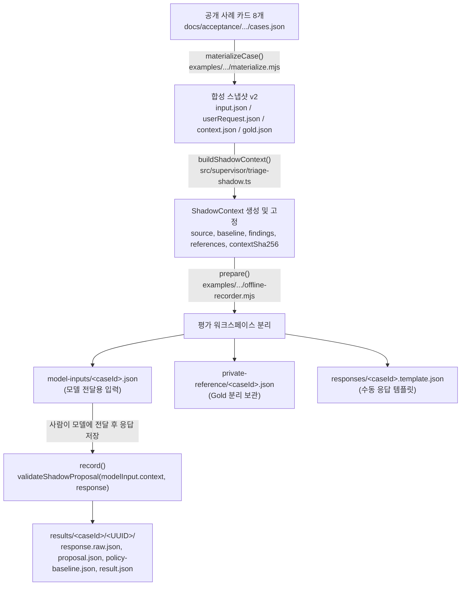

# ADTF 독립 QA 보고서 — 2차 블라인드 평가 입력 누출 감사

- **문서 상태:** 독립 QA 2차 오프라인 정적 분석 및 반례 재현 보고서 (`provisional_qa_audit_pending_human_review`)
- **대상 브랜치:** `qa/gemini-blind-input-audit` (최신 `main` 기반)
- **기준 커밋 SHA:** `08d57f0174a7b05f002dfdbf8ea29a5a3781568f` (PR #34 `2a2facf`, PR #35 `3c99292` 반영본)
- **검토 대상 파일:**
  - `AGENTS.md`, `docs/HANDOFF.md`
  - `docs/triage-semantic-evaluation-protocol-20261110.md`
  - `docs/triage-semantic-audit-20261110.md`
  - `docs/triage-semantic-evaluation-run-prep-20261110.md`
  - `docs/acceptance/triage-semantic-evaluation-20261110/cases.json`
  - `docs/acceptance/triage-semantic-audit-20261110/manifest.json`
  - `docs/acceptance/triage-semantic-audit-20261110/scorecard-blank-v2.json`
  - `examples/supervisor-triage-semantic/materialize.mjs`
  - `examples/supervisor-triage-semantic/offline-recorder.mjs`
  - `examples/supervisor-triage-semantic/offline-recorder-README.md`
  - `test/triage-offline-recorder.test.mjs`
  - `src/supervisor/triage-shadow.ts`
  - `src/planning/policy.ts`
- **주의사항:** 본 보고서의 기대 결과, 중립화 불변조건, 반례 판정은 사람의 최종 검수 전까지 **잠정안(`provisional`)**으로 취급한다. 이번 작업은 블라인드 투영 기능 자체를 구현하지 않으며, 현재 코드에서 실제로 재현되는 누출과 향후 Codex 구현 시 검증해야 할 안전 조건을 구분하여 기록한다.

---

## 1. 기준 브랜치와 SHA

- **현재 작업 브랜치:** `qa/gemini-blind-input-audit`
- **기준 HEAD SHA:** `08d57f0174a7b05f002dfdbf8ea29a5a3781568f` (`main`과 동일 커밋)
- **선행 커밋 이력:**
  - `08d57f0`: Merge pull request #35 (`3c99292` 중재 평가 사람 검수와 실행 조건 정리)
  - `2b15a75`: Merge pull request #34 (`2a2facf` 오프라인 중재 평가 기록기 추가)
  - `2426ebc`: Merge pull request #33 (중재 의미 평가 입력 점검과 v2)
- **기존 1차 QA 브랜치(`qa/gemini-independent-qa`):** 변경·초기화·병합 없이 독립 유지됨.

---

## 2. 현재 평가 입력의 데이터 흐름

현재 오프라인 중재 의미 평가 파이프라인은 다음 3단계를 거쳐 모델 입력 파일(`model-inputs/<caseId>.json`)과 결과 레코드(`results/<caseId>/<recordId>/*`)를 생성한다.

1. **합성 스냅샷 생성 (`examples/supervisor-triage-semantic/materialize.mjs` L21-L56):**
   - `cases.json`의 `card.id`(예: `plant-reviewer-overreach`)를 받아 다음 식별자를 문자열 템플릿으로 조립한다.
     - `projectId = "semantic-${card.id}"`
     - `scopeId = "semantic-${card.id}-scope"`
     - `planId = "semantic-${card.id}-plan"`
     - `issue.id = "issue-${card.id}"`
     - `review.id = "review-${card.id}-v${version}"`
     - `previousReview.id = "review-${card.id}-v1"`
   - 이 객체들을 `buildShadowContext(input, userRequest)`에 전달해 `context.json`을 생성한다.
2. **ShadowContext 조립 및 해시 결합 (`src/supervisor/triage-shadow.ts` L57-L106):**
   - `baseline = decideAfterReview(input)`을 호출해 기준 결정을 계산하고, `references["policy:baseline"] = JSON.stringify(baseline)`으로 직렬화한다.
   - `previousReview`가 있으면 `references["previous-review:source"]`에 `{ id, planId, planVersion }`을 직렬화하고, 각 이전 지적을 `references["previous-review:issue:${i.id}"]`에 저장한다.
   - 현재 지적을 `findings` 배열(`id: "review:${i.id}"`)과 `references["finding:review:${i.id}"]`에 추가한 뒤 전체 본문의 SHA-256을 `contextSha256`으로 계산한다.
3. **모델 입력 분리 및 검증 (`examples/supervisor-triage-semantic/offline-recorder.mjs` L38-L119):**
   - `prepare()`는 `gold.json`을 `private-reference/<caseId>.json`으로 분리하고, `model-inputs/<caseId>.json`에는 `{ schemaVersion, kind, source: { caseId, baseCommit, inputVersion, manifestSha256, contextSha256, contextFileSha256 }, context }`를 기록한다.
   - 이때 `offline-recorder.mjs` L56은 `assert.equal(context.source.planId, "semantic-" + caseId + "-plan")`으로 원본 `caseId`가 `planId`에 박혀 있을 것을 강제한다.
   - `record()`는 `model-inputs/<caseId>.json`의 `context`를 그대로 읽어 `validateShadowProposal(modelInput.context, validatorInput)`을 호출한다.

---

## 3. 확인된 누출 경로

PR #35(`docs/triage-semantic-evaluation-run-prep-20261110.md` L35, L39)에서는 `source.caseId`, `projectId`, `planId`, `reviewId`, `findingId`, `references` 키의 식별자 누출을 지적했다.

이번 독립 감사에서 전체 데이터 구조를 전수 조사한 결과, **PR #35에서 이미 식별된 6개 경로 외에도 직렬화된 JSON 문자열 내부·`baseline` 페이로드·출처 해시·합성 카드 메타 문장 등 7개의 추가 누출 경로(총 13개 경로)**가 확인되었다.

### 3.1 모델 입력(`model-inputs/<caseId>.json`) 내 누출 경로 전수 목록

| 구분 | 경로 번호 | 필드 / 위치 | 실제 노출 값 예시 (`plant-reviewer-overreach` / `plant-repeated-loss`) | PR #35 인지 여부 | 위험도 |
| :---: | :---: | --- | --- | :---: | :---: |
| **파일/래퍼** | **L-01** | 입력/템플릿 파일명 및 CLI 인자 (`offline-recorder.mjs` L63, L67) | `model-inputs/plant-reviewer-overreach.json`, `responses/plant-reviewer-overreach.template.json` | 부분 인지 | **High** |
| **파일/래퍼** | **L-02** | `modelInput.source.caseId` (`offline-recorder.mjs` L57) | `"plant-reviewer-overreach"`, `"umbrella-false-review"` | 인지됨 | **High** |
| **Context 출처** | **L-03** | `context.source.projectId` (`triage-shadow.ts` L103) | `"semantic-plant-reviewer-overreach"` | 인지됨 | **High** |
| **Context 출처** | **L-04** | `context.source.planId` (`triage-shadow.ts` L103, `offline-recorder.mjs` L56) | `"semantic-plant-reviewer-overreach-plan"` | 인지됨 | **High** |
| **Context 출처** | **L-05** | `context.source.scopeContractId` (`triage-shadow.ts` L103) | `"semantic-plant-reviewer-overreach-scope"` | **미언급 (신규)** | **High** |
| **Context 출처** | **L-06** | `context.source.reviewId` (`triage-shadow.ts` L104) | `"review-plant-reviewer-overreach-v1"` | 인지됨 | **High** |
| **Finding/Ref** | **L-07** | `context.findings[].id` 및 `context.references["finding:..."]` 키 (`triage-shadow.ts` L90-L92) | `"review:issue-plant-reviewer-overreach"`, `"finding:review:issue-plant-reviewer-overreach"` | 인지됨 | **High** |
| **이력 Ref** | **L-08** | `context.references["previous-review:issue:..."]` 키 (`triage-shadow.ts` L85) | `"previous-review:issue:issue-plant-repeated-loss"` | 인지됨 | **High** |
| **이력 직렬화** | **L-09** | `context.references["previous-review:source"]` **JSON 문자열 값 내부** (`triage-shadow.ts` L84) | `'{"id":"review-plant-repeated-loss-v1","planId":"semantic-plant-repeated-loss-plan","planVersion":1}'` | **미언급 (신규)** | **High** |
| **Baseline 객체** | **L-10** | `context.baseline` 내부의 `feedback`, `reason`, `issueIds`, `planId` (`policy.ts` L178, L200-L201, L207, L220) | `baseline.feedback`: `"issue-plant-reviewer-overreach: 완성하려면..."` `baseline.issueIds`: `["issue-plant-repeated-loss"]` `baseline.planId`: `"semantic-plant-explicit-sms-request-plan"` | **미언급 (신규)** | **Critical** |
| **Baseline 직렬화** | **L-11** | `context.references["policy:baseline"]` **JSON 문자열 값 내부** (`triage-shadow.ts` L80) | `'{"type":"REVISE","feedback":"issue-plant-reviewer-overreach: ...","nextVersion":2}'` | **미언급 (신규)** | **Critical** |
| **해시 역추적** | **L-12** | `modelInput.source.contextFileSha256`, `manifestSha256`, `context.source.inputSha256`, 원본 `contextSha256` (`offline-recorder.mjs` L57-L58) | 공개 저장소의 `manifest.json` 및 `scorecard-blank-v2.json`과 1:1 매칭되는 SHA-256 해시 | **미언급 (신규)** | **Medium** |
| **원문 메타 문구** | **L-13** | 합성 카드(`cases.json`)의 `planExcerpt` 및 `reviewFinding`에 포함된 평가자 시점 메타 서술 | `umbrella-limit`의 `reviewFinding`: `"수정 보완이 필요하지만 허용된 기획 반복 횟수를 모두 사용했다."` `plant-unrelated-citation`의 `reviewFinding`: `"삭제 범위를 설명할 때 L1의 제목 표시만 근거로 인용했다."` | **미언급 (신규)** | **Medium** |

> [!IMPORTANT]
> **가장 위험한 사각지대 (L-05, L-09, L-10, L-11):**
> 만약 블라인드 투영기를 구현할 때 `ShadowContext` 객체의 최상위 ID 필드(`caseId`, `projectId`, `planId`, `reviewId`, `findings[].id`, `references` 키)만 치환하면, **`context.source.scopeContractId`(L-05)**, **`context.baseline.feedback` / `reason` / `issueIds` / `planId`(L-10)**, 그리고 이미 `JSON.stringify()`로 직렬화된 문자열인 **`context.references["policy:baseline"]`(L-11)** 및 **`context.references["previous-review:source"]`(L-09)** 내부에 원본 시나리오 ID(`issue-plant-reviewer-overreach`, `issue-umbrella-false-review` 등)가 그대로 남게 된다.

### 3.2 일반 `ShadowContext` 확장 시 추가 잠재 누출 경로

현재 합성 사례 8개는 레거시 호환 형식(`qualityAssessment`, `storageAudit`, `revisionAudit` 미포함)이지만, 향후 전체 감사가 포함된 사례를 블라인드 투영할 때는 다음 경로에서도 ID가 문자열 내부에 삽입된다.

1. **`qualityFindings()` (`src/planning/review-quality.ts` L126, L131):**
   - `finding.description`과 `references["finding:quality:1"]`, `baseline.feedback`, `baseline.questions`에 `${entry.requirementId}: ${entry.rationale}` 형태로 Requirement ID가 삽입된다.
2. **`revisionFindings()` (`src/planning/revision-audit.ts` L138-L139):**
   - `finding.description`과 `references["finding:assurance:1"]`, `baseline.feedback`에 `이전 지적 ${r.issueId} 미해결/확인 필요: ${r.rationale}` 형태로 이전 지적 ID가 삽입된다.

---

## 4. 정답 힌트가 될 수 있는 정보와 정상 근거의 구분

블라인드 평가는 모델에게서 판단 근거를 빼앗는 것이 아니라, **실제 런타임에서는 존재하지 않는 평가 시나리오 라벨과 메타 힌트만 제거**하는 것이다. 따라서 제거/중립화 대상과 반드시 보존해야 할 정상 근거를 다음과 같이 엄격히 구분해야 한다.

| 분류 | 세부 항목 | 처리 방침 | 판단 이유 |
| --- | --- | :---: | --- |
| **1. 확정 누출 (제거 또는 중립화 필수)** | `caseId`, `projectId`, `planId`, `scopeContractId`, `reviewId`, `findingId`, `previousReview.id`, `previousReview.issues[].id`에 포함된 시나리오 명칭 (`overreach`, `false-review`, `repeated-loss`, `limit`, `unrelated-citation`, `explicit-sms-request`, `choice`, `invalid-input`) | **중립 ID로 치환** (`case-01`, `plan-01`, `issue-1` 등) | 실제 운영 환경에서는 이슈 ID가 해시(`issue-<sha256>`)나 순번으로 생성되며, `"false-review"`나 `"reviewer-overreach"`처럼 정답 분류를 직접 알려주는 ID는 존재하지 않는다. |
| **1. 확정 누출 (제거 또는 중립화 필수)** | `baseline.feedback`, `baseline.reason`, `baseline.issueIds`, `baseline.planId` 및 `references["policy:baseline"]`, `references["previous-review:source"]` 내부의 원본 ID 문자열 | **중립 ID가 반영된 상태로 재직렬화** | `baseline` 자체는 유지하되, 그 안에 박힌 `"issue-plant-reviewer-overreach"` 문자열은 중립 ID(`"issue-1"`)로 치환되어야 한다. |
| **1. 확정 누출 (제거 또는 중립화 필수)** | `gold.json`, `expectedCategories`, `forbiddenCategories`, `requiredEvidence`, `expectedAction`, `criticalMiss`, `scorecard-blank.json` | **`private-reference`로 완전 격리 (현재 완료)** | 평가 정답지 및 채점 기준표이므로 모델 입력에 직·간접적으로 포함되어서는 안 된다. |
| **1. 확정 누출 (제거 또는 중립화 필수)** | `modelInput.source.contextFileSha256`, `manifestSha256` 및 공개 매니페스트와 직결되는 원본 해시 | **`private-reference` 및 워크스페이스 `manifest.json`에만 보관** | 모델에게 전달되는 페이로드에는 투영된 `blindedContextSha256`만 포함하고, 원본 파일 해시 연결은 워크스페이스 매니페스트에서 검증한다. |
| **2. 간접 메타 힌트 (사람 검수 시 문구 보완 권장)** | `cases.json`의 `umbrella-limit`(`planExcerpt`: `"잘못된 위치 입력 처리 방식이 빠졌다"`, `reviewFinding`: `"...허용된 기획 반복 횟수를 모두 사용했다"`), `plant-unrelated-citation`(`reviewFinding`: `"...L1의 제목 표시만 근거로 인용했다"`), `plant-repeated-loss`(`planExcerpt`: `"...적었으나 구현 순서에서는 먼저 덮어쓴다"`) | **실제 Plan/Review 문체로 보완 권장** (사람 검수 안건) | 실제 기획안이나 Reviewer 지적문이 아니라 ‘평가 카드 요약문’이 원문 자리에 들어가 있어, 모델이 `iteration:state`나 `plan:L1`/`L2`를 직접 대조하지 않고도 문장 자체에서 메타 판정을 읽을 수 있다. |
| **3. 정상 근거 (보존 필수)** | `scope:goal`, `scope:requirement:R1`, `scope:excluded:1`, `scope:constraint:*`의 실제 요구사항 및 제외 기능 원문 | **원문 그대로 보존** | 중재 모델이 Scope 위반 여부와 데이터 보존 조건을 판단하기 위한 핵심 일차 근거다. |
| **3. 정상 근거 (보존 필수)** | `plan:L*`, `previous-plan:L*`의 기획안 줄별 원문 텍스트 | **원문 그대로 보존** | 인용 관련성(`plant-unrelated-citation`), 오독 여부(`umbrella-false-review`), 수정 전후 비교(`plant-repeated-loss`)에 필수적인 근거다. |
| **3. 정상 근거 (보존 필수)** | `finding:*`의 설명(`description`·`suggestedDirection`), `technicalBlocker` 불리언 값, `origin` 구분(`review`·`storage`·`quality`·`assurance`·`suggestion`) | **중립 ID 적용 후 보존** | 로컬 정책이 계산한 `technicalBlocker`와 지적 원문은 중재 모델이 권한 경계(`BLOCKER_DOWNGRADED` 방지)를 지키기 위해 반드시 알아야 하는 입력이다. |
| **3. 정상 근거 (보존 필수)** | `user:request` (별도 명시적 사용자 요청 원문, 없을 경우 키 미포함) | **원문 그대로 보존** | Reviewer의 일방적 Scope 확장 요구(`plant-reviewer-overreach`)와 사용자의 실제 Scope 변경 요청(`plant-explicit-sms-request`)을 구분하는 유일한 정당성 근거다. |
| **3. 정상 근거 (보존 필수)** | `iteration:state` (`{ iterationCount, maxIterations }`), `history:availability`, 중립 ID로 치환된 `previous-review:issue:*` 및 `policy:baseline` | **원문 구조 그대로 보존** | 반복 한도 도달 여부(`umbrella-limit`), 직전 지적 반복 여부(`plant-repeated-loss`), 그리고 기존 Policy 기준선(`baseline.type`) 대비 중재의 설명 가치를 비교하기 위한 필수 문맥이다. (실제로 `REVIEWER_RECHECK` 3개 사례의 `baseline.type`은 모두 `"REVISE"`이므로, `baseline.type`만 베끼면 오답이 된다.) |

---

## 5. 독립 반례

현재 코드(`materialize.mjs`, `offline-recorder.mjs`, `triage-shadow.ts`)에서 이미 발생하는 누출과, 블라인드 투영·역매핑 구현 시 발생할 수 있는 결함을 증명하는 **7개의 독립 반례(`Leak-CE-01` ~ `Leak-CE-07`)**를 구성했다. 모든 반례는 `tests-evaluation/supervisor-mediation/blind-input-leak-audit.test.mjs`에서 오프라인으로 즉시 실행·재현된다.

---

### 반례 1: `Leak-CE-01` — 원문을 전혀 읽지 않고 식별자 문자열만으로 8/8 (100%) 정답을 맞히는 Oracle 반례 (현재 코드에 이미 존재)

- **상황:** 식별자 문자열만 보고 정답 방향을 추측할 수 있는 경우.
- **재현 방법:**
  - `materializeAll()`과 `prepare()`가 생성한 8개 사례의 `model-inputs/<caseId>.json`에서 모든 한국어 원문(`scope`, `plan`, `finding.description`, `userRequest`)을 완전히 무시하고, 오직 `context.findings[0].id`(또는 `modelInput.source.caseId`)의 영문 부분 문자열만 검사하는 단순 분기 함수를 실행한다.
  - 규칙:
    - `id.includes("invalid-input")` → `WRITER_REWORK`
    - `id.includes("choice")` → `USER_CLARIFICATION`
    - `id.includes("overreach") || id.includes("false-review") || id.includes("unrelated-citation")` → `REVIEWER_RECHECK`
    - `id.includes("explicit-sms-request")` → `SCOPE_CHANGE_REQUIRED`
    - `id.includes("repeated-loss") || id.includes("limit")` → `ESCALATE_OR_STOP`
- **실제 결과:** 8개 사례 전체에서 `gold.expectedCategories[0]`와 **8/8 (100%) 일치**한다.
- **구분:** **현재 코드에 이미 존재하는 문제.**

---

### 반례 2: `Leak-CE-02` — PR #35에 언급된 필드만 중립화했을 때 다른 5개 필드에서 정답이 그대로 노출되는 부분 중립화 반례 (신규 발견 포함)

- **상황:** 일부 식별자만 중립화해 다른 필드에서 정답이 노출되는 경우.
- **재현 방법:**
  - PR #35(`docs/triage-semantic-evaluation-run-prep-20261110.md` L35)에서 지목한 `modelInput.source.caseId`, `context.source.projectId`, `context.source.planId`, `context.source.reviewId`, `context.findings[].id`, 그리고 `context.references`의 **키(Key)**들을 모두 `"neutral-01"`로 치환한다.
  - 그 후 직렬화된 `JSON.stringify(partiallyBlindedModelInput)` 내에 원본 시나리오 키워드(`reviewer-overreach`, `repeated-loss`, `explicit-sms-request`, `false-review`, `unrelated-citation`)가 남아 있는지 검사한다.
- **실제 결과:** 다음 **5곳의 값(Value) 및 미언급 필드**에서 원본 시나리오 이름이 그대로 검출된다.
  1. `context.source.scopeContractId`: `"semantic-plant-reviewer-overreach-scope"`
  2. `context.baseline.feedback` (`REVISE` 사례 5건): `"issue-plant-reviewer-overreach: ..."`
  3. `context.baseline.issueIds` 및 `context.baseline.planId` (`REQUEST_SCOPE_CHANGE_APPROVAL` 및 `STOP_REPEATED_REVIEW_ISSUES` 사례): `["issue-plant-explicit-sms-request"]`, `["issue-plant-repeated-loss"]`
  4. `context.references["policy:baseline"]`: 직렬화된 JSON 문자열 내부의 `"issue-plant-reviewer-overreach"` 등
  5. `context.references["previous-review:source"]`: 직렬화된 JSON 문자열 `'{"id":"review-plant-repeated-loss-v1","planId":"semantic-plant-repeated-loss-plan","planVersion":1}'`
  - 게다가 `offline-recorder.mjs` L56의 `assert.equal(context.source.planId, "semantic-" + caseId + "-plan")` 때문에 `caseId`와 `planId` 중 하나만 먼저 바꾸면 `prepare()`가 즉시 예외로 중단된다.
- **구분:** **현재 코드의 구조적 결합 문제 + PR #35 문서에서 누락된 신규 발견 누출 경로.**

---

### 반례 3: `Leak-CE-03` — 서로 다른 원본 ID가 동일 중립 ID로 충돌하거나 이전·현재 이력 ID 매핑이 어긋나는 반례 (향후 구현 위험)

- **상황:** 서로 다른 원본 ID가 동일 중립 ID로 충돌하는 경우.
- **재현 방법:**
  - **유형 A (다중 지적 충돌):** 한 Review 안에 `issue-plant-a`와 `issue-plant-b` 두 개의 지적이 있을 때, 단순 접두어 치환기(`id.replace(/^issue-plant-.*$/, "issue-1")`)를 적용하면 두 지적이 모두 `"review:issue-1"`이 되어 `buildShadowContext()` L91에서 `"Duplicate shadow finding source."` 예외가 발생하거나 `references["finding:review:issue-1"]`이 덮어써진다.
  - **유형 B (이력 순서 충돌):** v1 `previousReview.issues`가 `["issue-resolved-in-v2", "issue-repeated-loss"]`이고 v2 `review.issues`가 `["issue-repeated-loss", "issue-new-in-v2"]`일 때, 통합 심볼 테이블 없이 배열 인덱스 순서대로 각각 `issue-1`, `issue-2`로 번호를 매기면:
    - v1의 `"issue-repeated-loss"`는 `"issue-2"`가 되고, v2의 `"issue-repeated-loss"`는 `"issue-1"`이 된다.
    - 반면 v1의 `"issue-resolved-in-v2"`가 `"issue-1"`이 되어, v2의 `"issue-1"`(`issue-repeated-loss`)과 동일한 ID로 충돌함으로써 **해결된 과거 지적이 현재의 다른 지적과 반복된 것처럼 왜곡**되고 실제 반복된 지적은 연결이 끊어진다.
- **구분:** **향후 블라인드 투영 구현 시 발생할 수 있는 설계 반례.**

---

### 반례 4: `Leak-CE-04` — 중립화 후 Reference 키 불일치 및 `contextSha256` 무결성 파손 반례 (향후 구현 위험)

- **상황:** 중립화 후 reference가 깨지는 경우.
- **재현 방법:**
  - `context.findings[0].id`는 `"review:issue-1"`로 중립화했으나, ① `context.references`의 키 `"finding:review:issue-plant-invalid-input"`을 함께 치환하지 않거나, ② `scope.requiredFeatures[0].id`를 바꾸면서 `"scope:requirement:R1"`을 갱신하지 않거나, ③ 치환 후 `contextSha256`을 재계산하지 않은 상태에서 `validateShadowProposal()`을 호출한다.
- **실제 결과:**
  - ③ `contextSha256` 미갱신 시: `validateShadowProposal()`(`triage-shadow.ts` L115)이 `"Shadow context digest mismatch."` 예외를 던진다.
  - ①·② Reference 키 미갱신 시: 모델이 중립화된 `findingId: "review:issue-1"`을 사용해 응답하면 `MISSING_FINDING_REFERENCE:review:issue-1` 및 `INVALID_REFERENCE:review:issue-1`로 거부된다.
- **구분:** **향후 블라인드 투영 구현 시 발생할 수 있는 설계 반례.**

---

### 반례 5: `Leak-CE-05` — 배열 순서(Index) 기반 역매핑으로 인해 잘못된 Finding에 모델 응답이 연결되는 반례 (향후 구현 위험)

- **상황:** 역매핑 오류로 잘못된 finding에 응답이 연결되는 경우.
- **재현 방법:**
  - 한 사례에 두 개의 지적 `F1 = "review:issue-critical-loss"`(`technicalBlocker: true`, 중립 ID `"review:issue-1"`)와 `F2 = "review:issue-minor-question"`(`technicalBlocker: false`, 중립 ID `"review:issue-2"`)가 존재한다.
  - 모델이 응답 JSON의 `findings` 배열에 `[ { findingId: "review:issue-2", category: "USER_CLARIFICATION", ... }, { findingId: "review:issue-1", category: "WRITER_REWORK", ... } ]`처럼 **입력과 반대 순서**로 유효한 응답을 반환했다(`validateShadowProposal`은 배열 순서와 무관하게 `findingId`로 매칭하므로 정상 허용함).
  - 이때 역매핑기가 `findingId` 사전(Map) 조회 대신 배열 인덱스(`response.findings[i].findingId = originalContext.findings[i].id`)로 역매핑하거나, `evidenceRefs` 내부의 `"finding:review:issue-2"`를 역매핑하지 않는 경우를 시험한다.
- **실제 결과:**
  - 배열 인덱스 역매핑 시: 모델이 `"review:issue-2"`(질문)에 부여한 `"USER_CLARIFICATION"`이 원본의 `"review:issue-critical-loss"`(`technicalBlocker: true`)에 덮어써져, 원본 검증기에서 `BLOCKER_DOWNGRADED:review:issue-critical-loss` 오류가 발생하거나 채점 시 중대 실패(`critical_miss`)로 오판된다.
  - `evidenceRefs` 역매핑 누락 시: `findingId`는 `"review:issue-critical-loss"`로 복원되었으나 `evidenceRefs`에는 `"finding:review:issue-1"`이 남아 `INVALID_REFERENCE` 및 `MISSING_FINDING_REFERENCE`로 거부된다.
- **구분:** **향후 역매핑 구현 시 발생할 수 있는 설계 반례.**

---

### 반례 6: `Leak-CE-06` — 중립화된 다른 사례의 응답 교차 재사용(Cross-Case Replay) 및 출처 해시 체인 단절 반례 (향후 구현 위험)

- **상황:** 입력 해시는 정상처럼 보이지만 출처 연결이 불완전한 경우.
- **재현 방법:**
  - 모든 사례를 동일한 중립 ID 체계(`projectId: "eval-project"`, `planId: "eval-plan"`, `findingId: "review:issue-1"`, 참조 키 `"plan:L1"`, `"scope:requirement:R1"`)로 블라인드 투영하면, 사례 A(`plant-invalid-input`)와 사례 B(`umbrella-false-review`)의 중립 ID 및 참조 키 집합이 완전히 동일해진다.
  - 만약 `record()`가 응답을 역매핑할 때 ① `rawResponse.contextSha256 === blindedContext.contextSha256` 검사를 생략하고 바로 `restoredProposal.contextSha256 = originalContext.contextSha256`으로 덮어쓰거나, ② 워크스페이스 `manifest.json`에 `(originalContextSha256, mappingSha256, blindedContextSha256)` 3자 해시 체인을 고정하지 않으면, 사례 A에 대해 작성된 응답(또는 변조된 매핑표)이 사례 B의 결과로 둔갑해 `validateShadowProposal(originalContextB, restoredProposal)`을 그대로 통과한다!
- **실제 결과:** `rawResponse.contextSha256` 선행 검증 없이 역매핑 시 `contextSha256`을 원본 해시로 치환하면, 다른 사례의 응답이 구조 검증(`structurally_valid_for_manual_inspection`)을 통과함을 재현했다.
- **구분:** **향후 블라인드 기록기 구현 시 반드시 차단해야 할 보안/무결성 반례.**

---

### 반례 7: `Leak-CE-07` — 공개 매니페스트 해시 역추적 및 합성 원문 메타 서술을 통한 간접 Gold 노출 반례 (현재 자료에 존재)

- **상황:** Gold Label이 간접적으로 입력에 포함되는 경우.
- **재현 방법:**
  1. **해시 역추적 경로:** `offline-recorder.mjs` L57-L58이 `model-inputs/<caseId>.json`에 기록하는 `modelInput.source.contextFileSha256` 및 `context.contextSha256`을 저장소 내 공개 파일인 `docs/acceptance/triage-semantic-audit-20261110/manifest.json` 및 `scorecard-blank-v2.json`과 대조한다.
  2. **원문 메타 서술 경로:** 모든 ID와 해시를 블라인드 처리한 뒤에도, `cases.json`의 원문 텍스트(`plan:L1`, `finding:review:issue-1`)에 평가자 시점의 메타 판정 문구가 포함되어 있는지 검사한다.
- **실제 결과:**
  1. `modelInput.source.contextFileSha256` 또는 원본 `contextSha256`만으로 8개 사례 전체의 `caseId`가 100% 역추적된다.
  2. `umbrella-limit` 사례는 Reviewer 지적(`finding:review:issue-1`) 원문 자체가 `"수정 보완이 필요하지만 허용된 기획 반복 횟수를 모두 사용했다."`라고 되어 있어, 모델이 `iteration:state` 참조를 확인하지 않고도 지적 문장 자체에서 `ESCALATE_OR_STOP` 정답을 읽을 수 있다. `plant-unrelated-citation` 역시 지적 원문 자체가 `"삭제 범위를 설명할 때 L1의 제목 표시만 근거로 인용했다."`라는 메타 해설문으로 작성되어 있다.
- **구분:** **현재 코드 및 합성 평가 자료 v2에 이미 존재하는 문제.**

---

## 6. 블라인드 투영의 필수 안전 조건 (불변조건 9항)

향후 Codex가 블라인드 투영(`prepare`) 및 역매핑(`record`) 기능을 구현할 때 반드시 충족해야 하는 **9가지 불변조건(Invariants)**은 다음과 같다.

1. **[INV-1] 정답 암시 식별자의 완전 중립화 (Complete Identifier Neutralization):**
   - 모델에 전달되는 파일명, 디렉터리명, 그리고 JSON 페이로드 내의 **모든 식별자 위치(L-01 ~ L-11)**에서 원본 `caseId` 및 시나리오 암시 문자열이 제거되어야 한다.
   - 가장 안전하고 누락 없는 구현 방식은 `ShadowContext` 생성 후 문자열을 부분 치환하는 대신, **원본 `ShadowContextInput`(`input.json`)을 전단사 매핑표(`idMap`)로 중립화한 `blindedInput`으로 변환한 뒤 `buildShadowContext(blindedInput, userRequest)`를 호출**하여 `baseline`, `references["policy:baseline"]`, `references["previous-review:source"]`, `findings`, `contextSha256`이 처음부터 중립 ID로 일관되게 생성되게 하는 것이다. (만약 `context.json`만 입력받는 구조라면 L-01 ~ L-11의 모든 필드와 내부 직렬화 JSON을 파싱·재직렬화한 뒤 `contextSha256`을 재계산해야 한다.)
2. **[INV-2] 판단에 필요한 원문 근거의 무손실 보존 (Lossless Evidence Preservation):**
   - `scope:goal`, `scope:requirement:*`, `scope:excluded:*`, `scope:constraint:*`, `plan:L*`, `previous-plan:L*`, `user:request`, `iteration:state`, `history:availability`, 각 `finding`의 원문 설명과 `technicalBlocker` 및 `origin`, 그리고 중립 ID가 적용된 `policy:baseline`은 원문 그대로 보존되어야 한다.
3. **[INV-3] 단일 사례 내 전단사(Bijective) 매핑 일관성 (Intra-Case Bijective Consistency):**
   - 하나의 사례 안에서 동일한 원본 엔티티 ID는 위치(`source`, `baseline`, `findings`, `references` 키/값, `previousReview`)에 관계없이 항상 **동일한 중립 ID**로 매핑되어야 하며(단사·전사 함수 $f: \text{OrigID} \leftrightarrow \text{BlindID}$), 서로 다른 두 원본 ID가 동일한 중립 ID로 충돌해서는 안 된다.
   - 특히 `previousReview.issues`와 현재 `review.issues` 사이에 동일한 ID(반복 지적)가 있으면 동일한 중립 ID로, 서로 다른 ID가 있으면 서로 다른 중립 ID로 매핑되어야 한다.
4. **[INV-4] 매핑표 및 원본 해시의 완전 분리 (Strict Isolation of Mapping Table & Source Digests):**
   - 원본↔중립 ID 매핑표(`idMap`)와 원본 `caseId`, `originalContextSha256`, `contextFileSha256`, `gold.json`은 오직 `private-reference/`에만 저장하며, `model-inputs/` 및 `responses/*.template.json`에는 절대 포함하지 않는다.
   - 모델 입력 파일명과 템플릿 파일명도 `<blindCaseId>.json`(예: `case-01.json` 또는 난수/순번 토큰)을 사용하여 파일 경로를 통한 `caseId` 노출을 차단한다.
5. **[INV-5] 2단계 검증 및 결정론적 역매핑 (Two-Phase Validation & Key-Based Reverse Mapping):**
   - `record()` 실행 시:
     - **1단계 (투영 문맥 검증):** 모델이 제출한 원본 응답(`rawResponse`)의 `contextSha256`이 `blindedContext.contextSha256`과 정확히 일치하는지 확인하고, `validateShadowProposal(blindedContext, validatorInput)`으로 중립 상태에서의 구조·참조 유효성을 먼저 검증한다.
     - **2단계 (사전 기반 역매핑 및 원본 문맥 검증):** 배열 인덱스가 아닌 **`idMap.reverse` 사전 조회**를 통해 각 `finding.findingId`와 `finding.evidenceRefs` 내의 모든 참조 키를 원본 ID로 복원하고, `contextSha256`을 `originalContext.contextSha256`으로 변환한 뒤, 원본 `originalContext`에 대해 `validateShadowProposal(originalContext, restoredValidatorInput)`을 다시 통과시킨다.
6. **[INV-6] 역매핑 후 기존 출처·권한 경계 검증 유지 (Preservation of Existing Authority Gates):**
   - 역매핑 전·후 모두 `OMITTED_FINDING`, `DUPLICATE_FINDING`, `UNKNOWN_FINDING`, `INVALID_REFERENCE`, `MISSING_FINDING_REFERENCE`, `MISSING_PRIMARY_REFERENCE`, `BLOCKER_DOWNGRADED`, `USER_REQUEST_REQUIRED` 검증이 한 치의 완화도 없이 동일하게 통과되어야 한다.
7. **[INV-7] 4단계 암호학적 해시 체인 연결 (End-to-End Cryptographic Hash Chain):**
   - 워크스페이스 `manifest.json`과 `result.json`은 다음 해시들을 빠짐없이 기록하고 상호 대조해야 한다.
     - `sourceManifestSha256` (합성 스냅샷 v2 매니페스트 해시)
     - `originalContextSha256` (원본 `context.json`의 `contextSha256` — `scorecard-blank-v2.json`과 연결됨)
     - `mappingSha256` (`private-reference` 내 원본↔중립 매핑표 해시)
     - `blindedContextSha256` (블라인드 투영된 `context.contextSha256`)
     - `modelInputSha256` (`model-inputs/` 파일 바이트 해시)
     - `responseSha256` (모델이 반환한 중립 ID 상태의 `response.raw.json` 원본 바이트 해시)
     - `restoredProposalSha256` (원본 ID로 역매핑된 `proposal.json` 바이트 해시)
8. **[INV-8] 누락·중복·위조·원본 ID 혼입 응답의 즉시 거부 (Strict Rejection of Unmapped or Mixed IDs):**
   - 모델 응답에 매핑표(`idMap.reverse`)에 없는 ID가 들어 있거나, 우연히 원본 ID(`issue-plant-...`)를 그대로 적어냈거나, 중복·누락된 finding/reference가 있으면 역매핑 단계에서 즉시 거부하고 결과 디렉터리를 생성하지 않는다.
9. **[INV-9] 원본 평가 자료 불변 보장 (Immutability of Source Fixtures):**
   - `docs/acceptance/**`의 기존 파일, `cases.json`, `synthetic-snapshots-v2.tar.gz`, `manifest.json`, `scorecard-blank-v2.json`은 단 1바이트도 수정하지 않는다. 블라인드 투영은 오프라인 기록기(`prepare`)가 저장소 외부의 새 평가 워크스페이스를 생성할 때만 파생 사본으로 수행한다.

---

## 7. Codex 구현 시 필요한 회귀 테스트 제안

Codex가 블라인드 투영 기능을 구현할 때 기존 `test/triage-offline-recorder.test.mjs`에 다음 7가지 회귀 테스트를 추가할 것을 제안한다. (독립 프로토타입 검증 코드는 `tests-evaluation/supervisor-mediation/blind-input-leak-audit.test.mjs`에 작성 완료.)

1. **전수 문자열 비노출 검사 (Zero-Leakage Scan across All 8 Cases):**
   - 8개 사례 모두에 대해 `prepare()`가 생성한 `model-inputs/` 파일 전체 문자열(`JSON.stringify(modelInput)`)과 파일명에 각 사례의 `caseId` 및 시나리오 키워드(`invalid-input`, `choice`, `overreach`, `explicit-sms-request`, `false-review`, `repeated-loss`, `limit`, `unrelated-citation`), 그리고 원본 해시(`originalContextSha256`, `contextFileSha256`)가 포함되지 않음을 단언(`assert`).
2. **직렬화 내부 필드(`policy:baseline`, `previous-review:source`) 중립화 검사:**
   - `JSON.parse(blindedContext.references["policy:baseline"])` 및 `JSON.parse(blindedContext.references["previous-review:source"])` 내부의 `planId`, `id`, `issueIds`, `feedback`, `reason`에 중립 ID만 존재하는지 검증.
3. **전단사(Bijective) 매핑 및 이력 ID 정합성 검사:**
   - 다중 지적 및 `previousReview`가 있는 입력에서 동일 ID는 동일 중립 ID로, 상이한 ID는 상이한 중립 ID로 매핑되는지 검증.
4. **역순(Out-of-Order) `findings` 배열 응답의 정확한 역매핑 검사:**
   - 다중 지적 사례에서 모델이 `findings` 배열 순서를 뒤집어 응답했을 때도 `findingId` 사전 기반으로 정확히 원래 지적에 역매핑되어 통과하는지 검증.
5. **사례 간 응답 교차 재사용(Cross-Case Replay) 거부 검사:**
   - 사례 1의 블라인드 응답 파일을 사례 2 워크스페이스에 `record()`로 넣었을 때 `SOURCE_MISMATCH`로 거부되는지 검증.
6. **원본 ID 혼입 및 위조 중립 ID 거부 검사:**
   - 모델 응답이 중립 ID 대신 원본 ID(`review:issue-plant-...`)나 존재하지 않는 중립 ID(`review:issue-999`)를 사용했을 때 거부되는지 검증.
7. **해시 체인 및 `scorecard-blank-v2.json` 호환성 검사:**
   - `record()` 완료 후 `result.json`의 `sourceContextSha256`(`originalContextSha256`)이 `scorecard-blank-v2.json`의 해당 사례 `contextSha256`과 일치하고, `response.raw.json`은 블라인드 원본 바이트를, `proposal.json`은 역매핑된 제안을 각각 보존하는지 검증.

---

## 8. 현재 설계로 충분한 부분

블라인드 식별자 투영이 아직 구현되지 않았다는 점을 제외하면, 기존 PR #33~#35의 설계 중 다음 영역은 이미 견고하고 안전하다.

1. **`gold.json` 및 채점 기준 필드의 물리적 격리 (`offline-recorder.mjs` L30-L36, L63-L66):**
   - `expectedCategories`, `forbiddenCategories`, `requiredEvidence`, `expectedAction`, `criticalMiss`, `scorecard` 필드는 `model-inputs`에서 완전히 제외되어 `private-reference`에만 저장된다.
2. **원본 스냅샷 매니페스트 전수 해시 검증 및 경로 탈출 차단 (`offline-recorder.mjs` L14-L20, L47-L56):**
   - 심볼릭 링크 거부, 저장소 내부 출력 금지, `manifest.json`의 모든 파일 SHA-256 대조, `{ flag: 'wx' }` 원자적 쓰기를 통해 기존 평가 자료 덮어쓰기와 경로 탈출을 안전하게 차단하고 있다.
3. **Policy 기준선(`baseline.type`)의 비교 입력 제공 설계:**
   - 8개 사례 중 5개는 `REVISE`가 기준선이고 그중 3개(`plant-reviewer-overreach`, `umbrella-false-review`, `plant-unrelated-citation`)는 기대 분류가 `REVIEWER_RECHECK`이므로, `baseline.type` 자체는 정답 라벨이 아니며 중재자의 부가가치를 측정하기 위한 정당한 비교 기준선으로 작동한다(단, 내부 문자열의 ID 중립화는 필요).
4. **외부 API·SDK·네트워크 무호출 보장:**
   - `offline-recorder.mjs`와 `materialize.mjs`는 순수 Node.js 내장 모듈만 사용하며 외부 호출 경로가 전혀 없다.

---

## 9. 사용자 검수가 필요한 정책 결정

실제 블라인드 투영 구현 및 실모델 평가 착수 전에 사용자가 결정해야 할 사항은 다음 3가지다.

1. **합성 사례 3건(`umbrella-limit`, `plant-unrelated-citation`, `plant-repeated-loss`)의 원문 메타 서술 문구 보완 여부 (L-13 관련):**
   - 식별자를 모두 블라인드 처리하더라도, 현재 `umbrella-limit`의 `reviewFinding`(`"수정 보완이 필요하지만 허용된 기획 반복 횟수를 모두 사용했다."`)과 `plant-unrelated-citation`의 `reviewFinding`(`"삭제 범위를 설명할 때 L1의 제목 표시만 근거로 인용했다."`)은 문장 자체가 평가 정답을 설명하는 메타 문구다.
   - **선택지 A (권장):** 식별자 블라인드 투영기를 먼저 구현하되, 실제 유료 모델 호출 전에 해당 2~3개 사례의 `planExcerpt` / `reviewFinding`을 실제 기획안·Reviewer 지적 문체로 자연스럽게 다듬은 `v3` 합성 스냅샷(기존 `v1`·`v2` 보존)을 함께 준비한다.
   - **선택지 B:** 원자료(`v2`) 문구는 그대로 두고 식별자/해시만 블라인드 투영하여 진행하되, 보고서에 원문 문구의 힌트 가능성을 한계로 명시한다.
2. **블라인드 워크스페이스의 CLI 인터페이스 방식:**
   - `eval:triage-recorder -- prepare` 실행 시 기본적으로 블라인드 투영(`model-inputs/blinded-context.json` 또는 `--blind-id case-01`)을 생성할지, 아니면8개 사례 전체를 일괄 셔플·넘버링(`case-01` ~ `case-08`)하는 배치 `prepare-batch` 모드를 둘지 결정이 필요하다. (단일 사례씩 `prepare --case plant-reviewer-overreach`를 수동 실행하면 실행하는 사람은 순서를 알 수 있으나, 모델에게 전달되는 JSON 내부와 파일명을 `input.json`으로 통일하면 모델 측 블라인드는 성립한다.)
3. **역매핑된 `proposal.json`과 원본 `response.raw.json`의 병행 보존 형식:**
   - `response.raw.json`에는 모델이 중립 ID로 응답한 원본 바이트를 그대로 보존하고, `proposal.json`에는 원본 ID로 역매핑된 제안을 저장(또는 `proposal.blinded.json`과 `proposal.restored.json` 분리)하는 방식을 확정해야 한다.

---

## 10. Codex에게 전달할 검토 요청

Codex가 블라인드 투영 기능을 구현할 때 다음 5가지 사항을 반영할 것을 요청한다.

1. **`ShadowContext` 부분 치환 대신 `ShadowContextInput` 단계의 전단사 ID 중립화(또는 L-01 ~ L-12 전수 치환) 적용:**
   - PR #35에 적힌 필드(`caseId`, `projectId`, `planId`, `reviewId`, `findingId`, `references` 키)만 치환하면 `context.source.scopeContractId`(L-05), `context.baseline.feedback` / `reason` / `issueIds` / `planId`(L-10), `context.references["policy:baseline"]`(L-11), `context.references["previous-review:source"]`(L-09)에서 원본 ID가 그대로 누출된다.
   - `input.json`과 `userRequest.json`을 읽어 ID를 중립화한 뒤 `buildShadowContext()`를 다시 호출하거나, 위 12개 위치를 모두 파싱·재직렬화하고 `contextSha256`을 재계산해야 한다.
2. **`offline-recorder.mjs` L56의 고정 단언문 수정 및 `modelInput.source` 해시 격리:**
   - `assert.equal(context.source.planId, "semantic-" + caseId + "-plan")`은 원본 검증 단계에서만 수행하고, `model-inputs/`에 저장되는 JSON에서는 원본 `caseId`, `contextFileSha256`, `manifestSha256`, 원본 `contextSha256`을 제거(또는 투영 해시로 대체)하고 원본 해시 연결은 `private-reference/`와 워크스페이스 `manifest.json`에 기록할 것.
   - 모델에 전달할 파일명도 `${caseId}.json` 대신 중립 파일명(예: `model-inputs/input.json` 또는 `case-01.json`)을 사용할 것.
3. **이력(`previousReview`)과 현재(`review`) 간 동일/상이 ID의 전단사 매핑 보장:**
   - 반복 지적 사례(`plant-repeated-loss`) 및 다중 지적 사례에서 `previousReview.issues`와 `review.issues`의 ID 매핑이 어긋나거나 충돌하지 않도록 사례 단위 심볼 테이블(`idMap`)을 사용할 것.
4. **`record()`의 2단계 검증 및 사전(Map) 기반 역매핑 구현:**
   - 배열 인덱스 기반 역매핑을 금지하고 `idMap.reverse` 사전 조회로 `findingId`와 `evidenceRefs`를 모두 역매핑할 것.
   - 역매핑 전에 반드시 `rawResponse.contextSha256 === blindedContext.contextSha256` 및 `validateShadowProposal(blindedContext, ...)`을 먼저 검증하여 다른 사례 응답의 교차 재사용(`Leak-CE-06`)을 차단한 뒤, 역매핑된 제안을 `validateShadowProposal(originalContext, ...)`로 재검증할 것.
5. **1차 QA 보고서(`docs/evaluations/supervisor-mediation/policy-priority-audit.md`)와의 독립성 유지:**
   - 본 2차 감사는 평가 입력의 블라인드 투영 및 출처 해시 체인에 관한 것이며, Core `decideAfterReview()`의 분기 우선순위 수정과는 별도 PR/작업으로 분리하여 검증할 것.
